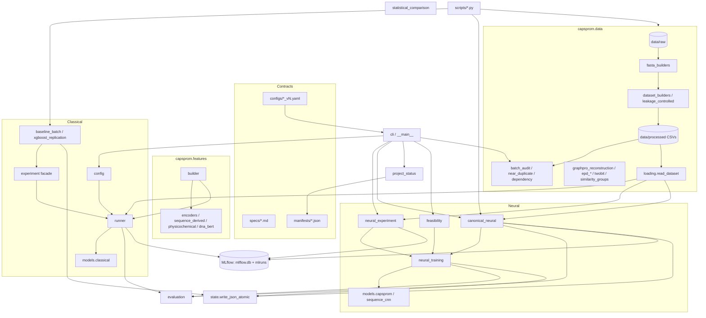
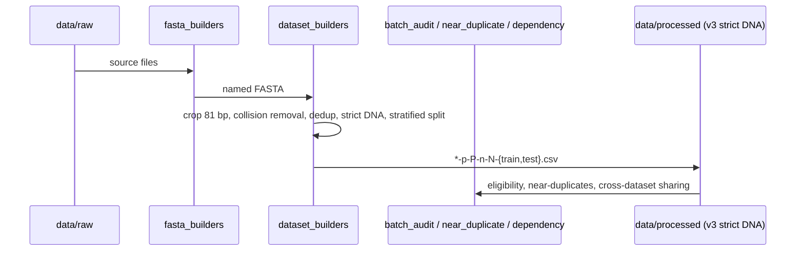
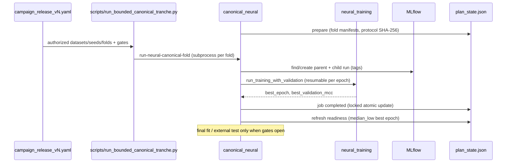

# Codebase Map

> Auto-generated by Cartographer. Last mapped: 2026-10-27T16:08:06Z.
> Token counts: cartographer scanner, tiktoken `cl100k_base`, `.gitignore` respected.
> Of the 458,729 tokens, 70,784 are generated EDA output under `outputs/eda/` (six larger EDA CSVs,
> about 1.1M tokens, are skipped by the scanner). Non-generated content is about 388k tokens:
> `src/capsprom` 90.6k, `configs` 67.3k, `docs` 120k (thesis 40.1k, ai-handover 11.3k),
> `scripts` 35.9k, `tests` 34.7k, `specs` 26.4k.

CapsProm is a doctoral research codebase for binary promoter prediction on 81 bp DNA windows
(60 upstream + TSS + 20 downstream; label 1 = promoter). It compares classical baselines
(logistic regression, XGBoost) with capsule networks (CapsProm) under strict leakage control,
hash-locked versioned YAML contracts, resumable state files and MLflow tracking.
Current phase and status live in `docs/roadmap.md` and `make status`, not in this map.

## System Overview



## Directory Structure

```
capsprom/
├── AGENTS.md              # Agent rules (research safety, scope, validation)
├── Makefile               # install-dev, lint, test, check, status, replication-*, baseline-consolidation
├── pyproject.toml         # Python >=3.13, src layout, console script `capsprom`
├── requirements/          # base, dev, models-classical, deep-learning, dna-bert-cpu, lock-py313
├── src/capsprom/          # Package (see Module Guide)
│   ├── data/              # Raw->FASTA->CSV builders, integrity audits, GraphPro/EPD reconstruction
│   ├── features/          # Feature-block registry and encoders
│   ├── models/            # classical factory, CapsProm (torch), CNN control
│   └── eda/               # Feature EDA tables + dependency-free SVG plots
├── scripts/               # Thin argparse wrappers: audits, builders, runners, validators, storage
├── tests/                 # Plain pytest; many contract tests read real configs
├── configs/               # ~113 versioned YAML contracts + README (immutable once state exists)
├── specs/                 # Scientific source of truth (protocols)
├── manifests/             # Tracked: current_status.json, remote_jobs.json
├── docs/                  # roadmap, reports, audits, ai-handover/, thesis/ (LaTeX), reports/
├── data/                  # Gitignored except README (raw/interim/processed)
├── outputs/               # Gitignored except outputs/eda/ (tracked EDA CSV/SVG)
├── mlflow.db, mlruns/     # Gitignored MLflow store
└── tmp/                   # Gitignored (6 PNGs in tmp/pdfs/ are force-tracked)
```

## Module Guide

### CLI and facade

| File | Purpose |
|---|---|
| `__main__.py` / `cli.py` | argparse CLI, `main()` returns exit code; `OSError`/`ValueError` become exit 2 |
| `experiment.py` | Thin re-export facade (`run_experiment`, `read_dataset`, `calculate_metrics`, `build_model`, ...). No logic; keep it that way |

CLI subcommands: `validate-config`, `validate-data`, `audit-data`, `run` (classical),
`audit-datasets`, `status [--write]`, `train-neural`, `prepare-neural-canonical`,
`run-neural-canonical-fold`, `refresh-neural-canonical-readiness`,
`run-neural-canonical-final-fit`, `run-neural-canonical-external-inference`,
`measure-neural-feasibility`. Batch, replication and consolidation run via Makefile/scripts.

### Shared infrastructure

| File | Exports | Notes |
|---|---|---|
| `config.py` | `ExperimentConfig`, `DataConfig`, `load_experiment_config` | Exact root-key set; paths resolve against **repo root** (`config.parent.parent`); model ∈ {logistic_regression, xgboost} |
| `state.py` | `write_json_atomic` | Temp file + fsync + `os.replace`; used everywhere |
| `tracking.py` | `resolve_tracking_uri` | Relative `sqlite:///` → absolute under repo root |
| `evaluation.py` | `calculate_metrics`, `expected_calibration_error`, `confusion_counts` | ECE uses equal-mass bins |
| `project_status.py` | `collect_project_status`, `write_status_snapshot` | Reads state files + `manifests/remote_jobs.json`; several hard-coded values (next action, dataset count) go stale |
| `remote_operations.py` | `build_pending_fold_schedule`, failure-event outbox, `backup_sqlite_store`, artifact snapshot manifest/verify | Filesystem-only notifications |

### Classical baselines

| File | Purpose |
|---|---|
| `runner.py` | `run_experiment`: read → encode (float32 batches) → fit → metrics → MLflow + `artifact_dir/<run_id>/` (config copy, predictions, fold manifest, summary with SHA-256s). Also `write_fold_manifest` (reused by canonical neural) |
| `models/classical.py` | `build_model` → (estimator, hyperparams, pip requirements) |
| `baseline_batch.py` | Resumable fixed-seed LR+XGB batch; generates immutable per-run YAMLs; per-run resume |
| `xgboost_replication.py` | Resumable 10-seed XGBoost; reuses seed-42 runs from baseline batch after config-equivalence check |
| `statistical_comparison.py` | Seed → dataset median → dependency-cluster median → Wilcoxon; Holm; paired stratified bootstrap |

### Neural (CapsProm)

| File | Purpose |
|---|---|
| `models/capsprom.py` | Torch CapsProm: Conv2d(1,256,(4,9)) → primary caps (dim 8) → dynamic routing (dim 16); optional decoder; `capsprom_loss`, `binary_capsule_predictions` (relative score `len1/(len0+len1)`, uncalibrated) |
| `models/sequence_cnn.py` | `SequenceCnnControl` CNN ablation control (BCE-with-logits) |
| `neural_training.py` | Training engine (`NEURAL_RUNNER_VERSION = 7`): `run_training_only`, `run_training_with_validation`, `run_fixed_epoch_training`, `predict_capsprom_checkpoint`. Early stopping on validation MCC; `best.pt` + `best.latest.pt` + `state.json`; contract SHA-256 locks resume |
| `neural_experiment.py` | Single-run YAML loader + MLflow wrapper (`train-neural`) |
| `canonical_neural.py` | Gated campaign orchestration: plan → inner folds → readiness (`median_low` of fold best epochs) → final fit → external inference. `fcntl` locks, MLflow parent/child runs found by tags, failure events, `external_test_accessed` flag |
| `feasibility.py` | Synthetic compute/memory projection (uses `resource`, POSIX-only) |
| `explainability.py` | First-conv max-activation windows → PFM/PPM/logo SVG + hashed manifest → MLflow |

### Data (`capsprom.data`)

| File | Purpose |
|---|---|
| `loading.py` | `read_dataset` (strict CSV, stratified cap, seeded shuffle, `row-NNNNNNNNN` ids), `audit_dataset_pair`, `sha256_file` |
| `sequences.py` | `SequenceRecord`, FASTA I/O, `crop_sequence` (81 bp) |
| `fasta_builders.py` | CNNProm / GraphPro / Bhandari / CDBProm raw → named FASTA (`{prom\|nonprom}-{study}-{domain}-{dataset}-{n}-{len}.fa`) |
| `dataset_builders.py` | Crop + split to `{study}-{domain}-{dataset}-p-P-n-N-{train\|test}.csv`. **Canonical**: `build_group_safe_intra_dataset_csvs_with_audit` (collision removal, dedup, strict DNA, per-dataset hash-seeded RNG). Legacy builder shares one RNG |
| `leakage_controlled.py` | Bhandari dedup + one mononucleotide shuffle per positive, pair-level split |
| `batch_audit.py` | `discover_dataset_pairs`, eligibility verdicts (`conflicting_labels` > `train_test_overlap` > `internal_duplicates` > `eligible`). Filename regex is the contract with baseline runners |
| `near_duplicate_audit.py` | Hamming ≤1/2/4/8 train→test neighbors (forward strand, pigeonhole index) |
| `similarity_groups.py` | Strand-invariant pair similarity components, group→partition assignment, cross-partition check |
| `dependency.py` | Cross-dataset exact sharing (v1 exact, v2 canonical strand-invariant) |
| `distribution_audit.py`, `sequence_logo.py` | GC/positional summaries, logo matrices |
| `integrity_treatment.py`, `downstream_control.py` | Exact and strand-invariant cleaning, EPD control exclusions near known TSS |
| `epd_resolution.py`, `epd_genomic_controls.py`, `twobit.py` | EPD BED parsing, GC-matched genomic controls, pure-Python `.2bit` reader |
| `graphpro_reconstruction.py` | GraphPro audits, Promotech source checks, bacterial positive/control reconstruction, canonical `reverse_complement` |
| `primary_tss_audit.py`, `ecoli_source_audit.py` | Deterministic TSS sample vs. primary supplements; E. coli pAA identity |

### Features (`capsprom.features`)

`builder.py` is the registry: `encoding` ∈ {`kmer_frequency`, `one_hot`, `physicochemical`,
`gc_content_skew`, `pseknc`, `dna_bert`}; `combination_mode` ∈ {`concatenate`, `multi_head`}
(classical config only allows `concatenate`). Encoders live in `encoders.py`,
`sequence_derived.py` (GC/skew, PseKNC), `physicochemical.py` (TSV tables in
`data/raw/references/`), `dna_bert.py` (lazy torch/transformers, `zhihan1996/DNA_bert_6`).

### EDA (`capsprom.eda`)

`feature_exploration.py` writes summary CSVs + `eda_report.md`; `plots.py` renders SVGs from them
without matplotlib. Output is tracked under `outputs/eda/`.

## Data Flow

### Dataset build



### Canonical CapsProm campaign



### Classical run

`config.load_experiment_config` → `runner.run_experiment` → `loading.read_dataset` →
`features.build_feature_set` → `models.classical.build_model` → `evaluation.calculate_metrics`
→ MLflow + `artifact_dir/<run_id>/`. Batches/replications expand one YAML into per-run YAMLs and
persist state after each run.

## Conventions

- **Versioned contracts**: change data, features, seeds, models, output policy or inference → new
  `*_vN.yaml` plus new state/output paths. State files store the config SHA-256 and refuse resume
  on mismatch. Never edit a used contract.
- **Atomic, resumable state**: `state.write_json_atomic` after every run/epoch/job.
- **Deterministic seeds** derived from `sha256(seed:identity)` rather than shared RNG streams.
- **Strict ACGT** downstream of builders; 81 bp window; filenames encode class counts.
- **Gates**: `execution_gates` in YAML (`canonical_jobs_enabled`, `final_fits_enabled`,
  `external_test_enabled`, `embedding_jobs_enabled`) plus plan-state `external_test_accessed`.
- **Tests**: plain pytest functions, no conftest, synthetic data in `tmp_path`;
  `pytest.importorskip("torch")` for model/training tests. Contract tests read real configs.
- **Lint**: `ruff check src tests scripts`, line length 100, target py313.
- **Docs/specs/config/code in English**; figures and tables need caption, label and prior mention
  (`specs/academic_writing_spec.md`).

## Gotchas

- **POSIX-only imports**: `canonical_neural` (`fcntl`) and `feasibility` (`resource`) are imported
  eagerly by `cli.py`, so `python -m capsprom` needs Linux/WSL. The Makefile default
  `PYTHON=.venv/bin/python` is also POSIX layout.
- **Confirmatory scope** is only the 18 CDBProm/CNNProm identities in
  `data/processed/assembled_datasets/intra_regenerated_v3_strict_dna/`. GraphPro (8 pairs) is
  excluded and deferred (`graphpro_deferral_policy_v1.yaml`); legacy `intra/` data is provenance only;
  Bhandari is a synthetic-shuffle development control.
- **Statistical unit** across datasets is the dependency cluster (14), never folds or seeds.
- **Exact vs. strand-invariant** leakage controls coexist and are not interchangeable.
- `config.py` resolves relative paths against the repo root, not the config's directory.
- `runner.run_experiment` evaluates the test split in the same call; never use it for selection.
- Classical training happens before the MLflow run opens; a crash leaves no MLflow trace.
- `test_capsprom_campaign_release` globs all release YAMLs and asserts smallest-first schedule and
  seed order; adding/renumbering releases can break it.
- `project_status.py` hard-codes the next action and dataset counts; update it with each release.
- `README.md` and `docs/processed_dataset_validation_summary.md` are stale;
  `docs/ai-handover/` may lag `manifests/current_status.json`.
- CI (`.github/workflows/ci.yml`) does not install torch, so neural tests skip there.
- Reconstruction output depends on input pair order (earlier pairs claim genomic windows).

## Navigation Guide

- **Run a new canonical tranche**: add `configs/capsprom_campaign_release_vN.yaml` (next dataset,
  smallest first), run `scripts/run_bounded_canonical_tranche.py` on the remote host, update
  `project_status.py` next action, `make status-snapshot`, update `docs/roadmap.md`.
- **Change neural training behavior**: `neural_training.py` (bump `contract_version` /
  `NEURAL_RUNNER_VERSION`, keep `_serializable_contract` stable for old versions), new config,
  tests in `tests/test_neural_training.py` / `tests/test_canonical_neural.py`.
- **Change CapsProm architecture**: `models/capsprom.py`, `specs/capsprom_reproduction.md`,
  `tests/test_capsprom_model.py`.
- **Add a feature encoding**: encoder in `features/`, branch in `features/builder.py`, export in
  `features/__init__.py`, spec in `specs/feature_architecture.md`, test in
  `tests/test_feature_engineering.py`.
- **Add a classical model**: `models/classical.py`, allowed names in `config.py`.
- **Add a CLI command**: `cli.py`; put logic in a domain module, not `experiment.py`.
- **Build or audit datasets**: `src/capsprom/data/*` + a thin `scripts/` wrapper + versioned config.
- **Statistical comparison**: `statistical_comparison.py`, `configs/evaluation_protocol_v3.yaml`,
  `specs/statistical_evaluation_protocol.md`, `scripts/consolidate_active_baselines.py`.
- **Remote jobs**: `docs/remote_job_operations.md`, `manifests/remote_jobs.json`,
  `configs/capsprom_remote_usage_policy_v3.yaml`, `remote_operations.py`.
- **Thesis**: `docs/thesis/` (LaTeX chapters, `references.bib`).
