# Data-to-Features Flow

This document consolidates, in one flow, the path from official upstream
repositories to model-ready feature blocks. It introduces no new rule: every
step restates a contract already defined in the specifications listed in
[Sources](#sources). If this document and a specification disagree, the
specification wins.

## Stages

1. **Source declaration.** Every upstream file is declared in a versioned
   acquisition config (`configs/source_acquisition_v1.yaml`) with its access
   identifier and, when available, its digest.
2. **Acquisition.** Files are downloaded into
   `data/acquired/source_acquisition_v1/` and verified. The branch depends on
   the source kind (pinned GitHub tree or direct URL), on whether a digest is
   declared, and on failure modes (TLS chain, digest mismatch, changed config).
3. **Provenance recording.** Manifests are snapshotted under
   `manifests/provenance/`, upstream dates and the legacy inventory are
   recorded, and procedures go to `docs/provenance/research_log.md`.
4. **Routing by file type.** Sequence collections are canonicalized; reference
   files (genomes, BED/coordinate tables, EPD, supplements, physicochemical
   tables) are hashed only and feed later coordinate reconstruction.
5. **Canonicalization.** Minimal cleaning (whitespace removal, uppercasing),
   one byte-reproducible canonical table per collection, and validation against
   release counts and legacy parity. Nothing is dropped, cropped, deduplicated,
   or relabelled here.
6. **Dataset build.** A separately versioned build config names the canonical
   collection IDs and manifest SHA-256. The branch depends on the source family
   and on the negative condition. Every filter writes a JSON and CSV ledger.
7. **Integrity audit and eligibility.** Each train/test pair is classified;
   only eligible pairs enter the eligibility and dependency manifests.
8. **Model-ready contract.** `sequence` (81 bp, A/C/G/T) and `label` (0/1) CSV
   files following the naming convention.
9. **Feature transformation.** Feature blocks declared in YAML are validated,
   encoded, fitted on training data only where they learn from data, combined
   by model family, and logged to MLflow.

## Flowchart

Figure 1 (label `fig:data-to-features-flow`) shows the complete flow. Diamonds
are decisions; dashed red edges end in a stop or a new versioned identity
instead of continuing the current one.

```mermaid
flowchart TD
    classDef stop fill:#FCEBEB,stroke:#A32D2D,color:#501313
    classDef ref fill:#EEEDFE,stroke:#534AB7,color:#26215C
    classDef out fill:#E1F5EE,stroke:#0F6E56,color:#04342C

    %% 1. Declaration
    S0(["Official repositories: GitHub, CDBProm site, Google Drive, EPD/EPDnew, BDGP, UCSC, Promotech"])
    S0 --> C1["Declare sources in configs/source_acquisition_v1.yaml"]

    %% 2. Acquisition
    subgraph ACQ["2. Acquisition - scripts/acquire_sources.py --execute"]
        C1 --> H1{"Config SHA-256 equals manifest?"}
        H1 -- "no" --> V2["Refuse run; create source_acquisition_v2"]:::stop
        H1 -- "yes or first run" --> K{"Source kind"}
        K -- "github_tree" --> G1["Pin full 40-hex commit"] --> G2["Expand file list from commit tree; freeze in manifest"] --> G3["Verify Git blob SHA-1 per file"]
        K -- "url_list" --> T{"Server sends full TLS chain?"}
        T -- "no" --> T2["Trust issuer AIA intermediate pinned by SHA-256; never disable TLS"] --> D
        T -- "yes" --> D{"Digest declared?"}
        D -- "yes: sha256 / md5 / git_blob_sha1" --> U1["Verify every declared digest"]
        D -- "no" --> U2["Trust on first use; verify against manifest on later runs"]
        G3 --> M{"Digest matches?"}
        U1 --> M
        U2 --> W
        M -- "no" --> F1["Delete file; record run as failed; retry once"]:::stop
        F1 -- "persists: upstream changed" --> V2
        M -- "yes" --> W["Stream to .part; atomic rename; write manifest after each file"]
        W --> R1["Append runs[] entry; record acquired_at and upstream headers"]
    end

    %% 3. Provenance
    R1 --> P1["scripts/record_provenance.py: snapshot, source-metadata, legacy-inventory, replay-v3"]
    P1 --> P2["Log procedure in docs/provenance/research_log.md; findings in findings_register.md"]

    %% 4. Routing
    P2 --> FT{"File type"}
    FT -- "genomes 2bit/FASTA, BED, EPD, supplements, DDS matrix, code" --> REF["Reference files: hashed, not canonicalized"]:::ref
    FT -- "sequence collections" --> CN1

    %% 5. Canonicalization
    subgraph CAN["5. Canonicalization - scripts/canonicalize_sources.py"]
        CN1["Check input SHA-256 against acquisition manifest"] --> CN2["Parse FASTA, line files, zip members"]
        CN2 --> CN3["Clean: remove whitespace, uppercase; flag case_normalized"]
        CN3 --> CN4["Write collection_id.csv.gz with record_id, source_class, label, strict_dna, duplicate_of, cross_label_collision"]
        CN4 --> CV1{"Per-class counts equal release counts?"}
        CV1 -- "no" --> CF["Collection fails; script exits 1; investigate"]:::stop
        CV1 -- "yes" --> CV2{"Legacy inputs declared?"}
        CV2 -- "yes" --> CV3{"Per-class sequence multiset equals data/raw copy?"}
        CV3 -- "no" --> CF
        CV3 -- "yes" --> CM
        CV2 -- "no" --> CM["Record pass in canonical_manifest.json"]
    end

    %% 6. Dataset build
    CM --> B0["Versioned build config names collection IDs and canonical manifest SHA-256"]
    B0 --> FAM{"Source family"}

    FAM -- "CDBProm / CNNProm: source-native negatives" --> N1["Crop 81 bp: 60 upstream + TSS + 20 downstream"]
    N1 --> N2["Remove every cross-label collision from both classes"]
    N2 --> N3["Remove same-label exact duplicates"]
    N3 --> N4["Strict-DNA filter"]
    N4 --> N5["Deterministic unique-sequence group split"]

    FAM -- "Bhandari: promoter-only source" --> BH1["Deduplicate positive windows"]
    BH1 --> BH2["One deterministic mononucleotide shuffle per positive"]
    BH2 --> BH3["Assign each positive-shuffle group wholly to train or test"]
    BH3 --> BH4["Label as synthetic shuffle control; development only"]

    FAM -- "GraphPro: released labels exploratory only" --> GP0{"Organism domain"}
    GP0 -- "bacterial" --> GB1{"Contig and assembly verified against primary TSS table?"}
    GB1 -- "no, e.g. ECOLI.bed on NC_000913.3" --> GBX["Invalidate derived windows; new identity on the correct contig, e.g. pAA NC_018666.1"]:::stop
    GB1 -- "yes" --> GB2["Extract oriented 81 bp window from documented TSS"]
    GP0 -- "human / mouse" --> GE1{"FP identifier resolves in dated EPD release?"}
    GE1 -- "no" --> GEX["Exclude and count"]:::stop
    GE1 -- "yes" --> GE2["Union of positive candidates; one group per TSS"]
    GB2 --> NEG
    GE2 --> NEG["GC-matched genomic control per positive: outside TSS radius, no overlap, strict DNA, no forward or reverse-complement identity, GC caliper"]
    NEG --> NEGX{"Control equals an external active positive?"}
    NEGX -- "yes" --> NEGR["Exclude control under hash-bound rule; keep ledger entry"]:::stop
    NEGX -- "no" --> GG["Per-organism eligibility gates 1-8"]

    FAM -- "Alternative negative conditions" --> ALT{"Condition"}
    ALT -- "CDS-derived" --> ALT1["Versioned CDS policy; separate identity"]
    ALT -- "dinucleotide shuffle" --> ALT2["New dataset identity"]
    ALT -- "multi-negative" --> ALT3["Training-exposure ablation; panels stay separate"]

    N5 --> LED
    BH4 --> LED
    GG --> LED
    ALT1 --> LED
    ALT2 --> LED
    ALT3 --> LED
    LED["Filtering ledger per stage: input, removed by class, output, order, hashes in JSON and CSV"]

    %% 7. Integrity audit
    subgraph AUD["7. Integrity audit and eligibility"]
        LED --> A1["Audit duplicates, label conflicts, train/test overlap, reverse complement, Hamming 1/2/4/8 near duplicates, class vs strand proxy"]
        A1 --> A2{"Pair classification"}
        A2 -- "invalid / conflicting_labels / train_test_overlap / internal_duplicates" --> AX["Not admitted; needs source-aware correction and new manifest"]:::stop
        A2 -- "eligible" --> A3["Eligibility manifest and dependency clusters"]
    end

    %% 8. Model-ready contract
    A3 --> MR["Model-ready CSV: sequence 81 bp A/C/G/T, label 0/1; study-organism-name-p-N-n-N-partition.csv"]:::out
    REF -.-> GB1
    REF -.-> GE1
    REF -.-> NEG

    %% 9. Features
    subgraph FEAT["9. Feature transformation - capsprom.features"]
        MR --> FC["Feature blocks declared in experiment YAML"]
        FC --> FV{"Config valid? strict DNA, length 81, k constraints, known property names"}
        FV -- "no" --> FVX["Fail configuration validation; no silent fallback"]:::stop
        FV -- "yes" --> ENC{"Encoding"}
        ENC -- "one_hot" --> E1["k=1: 81 x 4; k=2 ablation only: 80 x 16"]
        ENC -- "kmer_frequency" --> E2["4^k vector; small predeclared k"]
        ENC -- "physicochemical" --> E3["k=2 normalized-dinuc.tsv, 38 properties; k=3 normalized-trinuc.tsv, 12; all or ordered named subset"]
        ENC -- "gc_content_skew" --> E4["Global and windowed GC content and skew"]
        ENC -- "pseknc" --> E5["PseDNC k=2 or PseTNC k=3: 4^k + lambda; record table, properties, lambda, w"]
        ENC -- "dna_bert" --> E6{"DNA-BERT mode"}
        E6 -- "frozen encoder" --> E6a["zhihan1996/DNA_bert_6; cache by sequence hash, model revision, tokenizer"]
        E6 -- "trainable encoder" --> E6b["Fit inside each training fold"]
        E1 --> FIT
        E2 --> FIT
        E3 --> FIT
        E4 --> FIT
        E5 --> FIT
        E6a --> FIT
        E6b --> FIT
        FIT{"Transform learns from data?"}
        FIT -- "yes" --> FT1["Fit on training folds only: 5-fold stratified CV, seed 42; never on test"]
        FIT -- "no" --> CMB
        FT1 --> CMB{"Model family"}
        CMB -- "classical: logistic, XGBoost" --> O1["combination_mode: concatenate; flattened vector"]:::out
        CMB -- "neural multi-head" --> O2["input_mode: multi_head; named blocks, explicit fusion"]:::out
        CMB -- "basic CapsProm baseline" --> O3["one_hot k=1 only: tensor batch x 81 x 4"]:::out
    end

    O1 --> LOG["Log to MLflow: block names, shapes, metadata, reference hashes, pretrained model IDs, dataset and config hashes"]
    O2 --> LOG
    O3 --> LOG
```

*Figure 1 (`fig:data-to-features-flow`). Data-to-features flow in CapsProm,
from official repositories through acquisition, provenance recording,
canonicalization, source-specific dataset builds, integrity audit, and feature
transformation. Purple nodes are reference files used by coordinate
reconstruction; red nodes stop the current identity or require a new versioned
one; green nodes are model-ready outputs.*

## Individual branches

| Branch point | Cases | Contract |
| --- | --- | --- |
| Acquisition config hash | unchanged / changed | changed config is refused; new `source_acquisition_vN` |
| Source kind | `github_tree` / `url_list` | commit-pinned tree with blob SHA-1 / declared digests or trust on first use |
| TLS chain | complete / missing intermediate | pin the issuer AIA certificate by SHA-256 |
| Digest | match / mismatch | mismatch deletes the file, retries once, then requires a new version |
| File type | sequence collection / reference file | canonicalize / hash only |
| Canonical validation | pass / fail | exact release counts and legacy parity |
| Source family | CDBProm and CNNProm / Bhandari / GraphPro / alternative negatives | see stage 6 |
| GraphPro domain | bacterial / human and mouse | verified contig and TSS / resolved EPD identifier |
| Pair classification | eligible / four non-eligible classes | only eligible pairs are admitted |
| Encoding | six families | k constraints from the feature architecture |
| DNA-BERT mode | frozen / trainable | cached by hash / fitted inside each fold |
| Model family | classical / multi-head / basic CapsProm | concatenate / named blocks / `81 x 4` one-hot |

## Sources

- `specs/source_acquisition_protocol.md`
- `specs/data_provenance_policy.md`
- `specs/project_spec.md`
- `specs/dataset_integrity_audit.md`
- `specs/graphpro_dataset_reconstruction.md`
- `specs/negative_control_protocol.md`
- `specs/statistical_evaluation_protocol.md`
- `specs/feature_architecture.md`
- `specs/capsprom_canonical_experiment.md`
- `docs/data_pipeline_operations.md`
