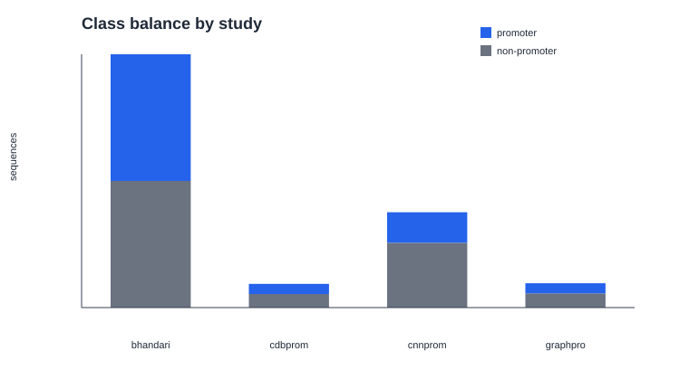
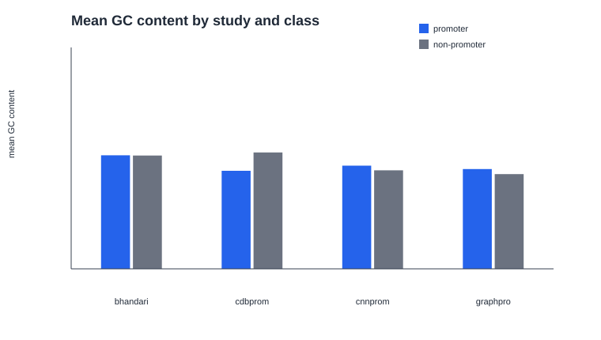
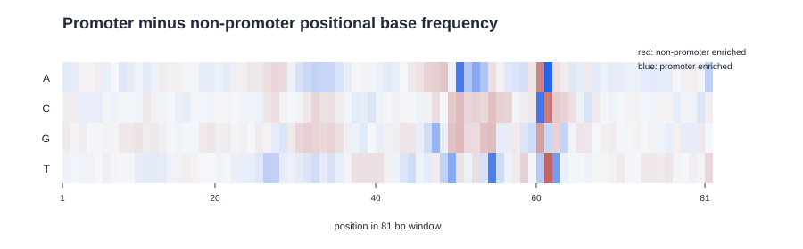
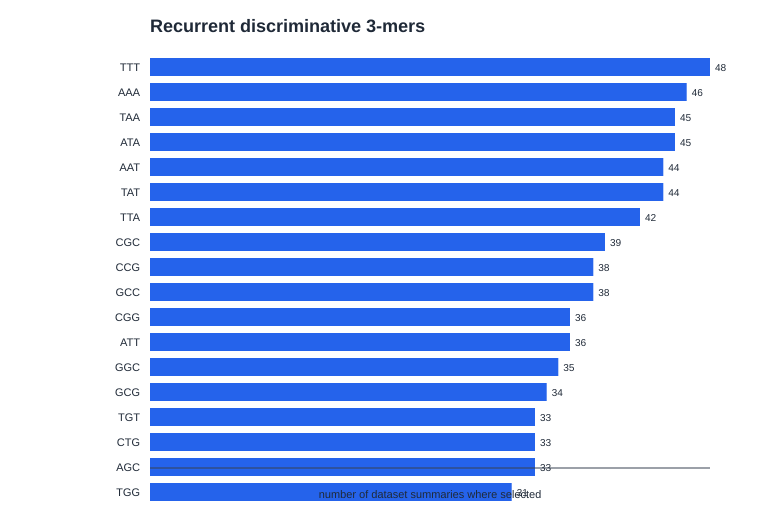
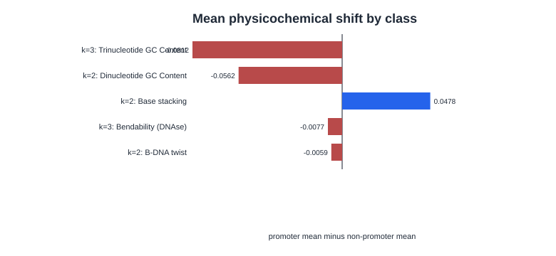

# Feature-Oriented EDA Figures

This report introduces graphical artifacts generated from the strict-DNA intra-source EDA tables. The figures are descriptive and should be used to guide interpretation and later ablation planning, not as final supervised feature selection evidence.

Figure `fig:eda-class-balance-by-study` summarizes the number of promoter and non-promoter sequences retained in each strict-DNA source group.

Caption: Class balance by source study after strict-DNA cleaning. Bars aggregate train and test partitions and separate promoter from non-promoter examples.

Figure `fig:eda-gc-content-by-study-class` summarizes class-wise mean GC content for each source group.

Caption: Mean GC content by source study and class. Values are averaged across dataset-level EDA summaries and provide an interpretable compositional comparison between promoter and non-promoter windows.

Figure `fig:eda-positional-base-frequency-difference` summarizes position-specific nucleotide differences between promoter and non-promoter sequences.

Caption: Promoter minus non-promoter positional base-frequency differences after strict-DNA cleaning. Columns correspond to positions in the 81 bp window and rows correspond to A, C, G, and T.

Figure `fig:eda-recurrent-discriminative-trimers` summarizes which 3-mers recur most often among the strongest class-wise k-mer differences.

Caption: Most recurrent discriminative 3-mers across strict-DNA intra-source dataset summaries. Counts indicate how often each 3-mer appears among the top class-wise frequency differences.

Figure `fig:eda-physicochemical-property-shift` summarizes average class-wise shifts for selected dinucleotide and trinucleotide physicochemical properties.

Caption: Mean promoter minus non-promoter shift for selected normalized physicochemical properties. Positive values indicate higher average property values in promoter windows.
